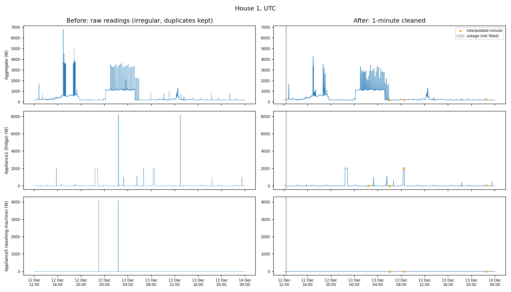
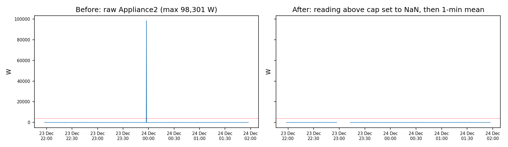
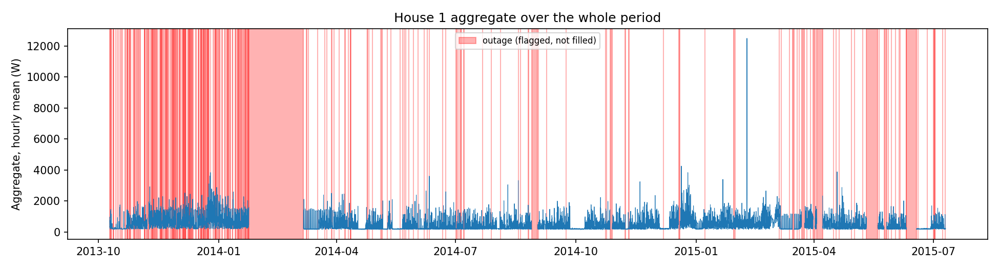

# DATA.md: coverage, quality findings and cleaning (Task 1)

This file covers the raw House 1 data (Task 1). The cleaned-data checks for Tasks 2 and 3 are in `RESULTS.md`.

## 1. Data and coverage

| Item | Detail |
|---|---|
| Dataset | REFIT Electrical Load Measurements, University of Strathclyde (raw and cleaned releases, 08/11/2016) |
| Task 1 files | `RAW_House1_Part1.csv`, `RAW_House1_Part2.csv` |
| Period | 2013-10-09 to 2015-07-10 (about 639 days) |
| Sampling | Active power polled about every 6 to 8 seconds, resampled by me to 1 minute (mean) |
| Units | Watts |
| Channels | Aggregate plus 9 individual appliance monitors (IAMs) |

**Limitations stated in the dataset readme.** Data was recorded only when the load changed and was then filled in; the sensors are not synchronised; there were outages, notably February 2014. Part 1 of the raw files writes 0 for unavailable sensors, while Part 2 writes NaN. The two parts are two iterations of the same database and overlap in time by about three months.

## 2. Inspection findings (raw House 1)

- **Timestamp parsing and ordering.** The `Time` column is local time and is not corrected for daylight saving. It jumps backwards on 2013-10-27 (clocks go back) and shows a 3604 s jump on 2014-03-30 (clocks go forward); neither is an outage. A further backward step on 2014-08-15 is a 1-second rounding difference. The `Unix` column (UTC) is unambiguous, so it is the time axis. Part 2 is ordered, with no backward steps.
- **Duplicate timestamps.** Part 2 has none. Part 1 has about 1.0 million repeated Unix timestamps (about 23% of its rows).
- **Irregular intervals.** The typical interval in Part 2 is 7 seconds. The longest gaps are about 8.6 days in Part 2 and about 41.6 days in Part 1 (the early-2014 outage the readme mentions).
- **Missing readings.** Part 1 has no NaNs because unavailable sensors are written as 0, so missing data is hidden there. Part 2 has many NaNs (about 189,000 in the aggregate, about 1.9 million in Appliance9).
- **Impossible or extreme values.** Values such as 98,301 W, 73,725 W, 65,535 W and 32,767 W appear. They look like sensor or register glitches and are far above any plausible domestic load.

## 3. Cleaning pipeline (`src/pipeline.py`)

Every rule is a function argument or a documented step, so the whole pipeline is in one place.

1. **Load and combine** Part 2 and Part 1. Part 2 has priority (pass the paths in priority order).
2. **Overlap rule.** Any Part 1 row inside Part 2's time span is dropped. Exact-timestamp de-duplication is not enough: the two files are sampled at different instants, so averaging Part 1's zeros with Part 2's NaNs would bias the appliance means low.
3. **Time axis** = Unix timestamp (UTC). Rows with an unparseable timestamp are dropped.
4. **Sort** by Unix (stable sort).
5. **Duplicates:** for repeated Unix timestamps, keep the first row (after sorting by Unix and file priority).
6. **Extreme values:** readings above 4000 W (appliance channels; the cap the REFIT cleaning also uses) or 15,000 W (aggregate; my own choice) are set to NaN before resampling, so one glitch cannot contaminate a 1-minute mean.
7. **Resample** to 1 minute with the mean (power is a rate).
8. **Gaps.** Runs of 5 missing minutes or fewer are linearly interpolated and flagged. Longer runs are never filled and are flagged as outages. Leading and trailing gaps are never filled.

**A bug I fixed.** My first version used the standard interpolation call with a limit of 3 minutes. That fills the first 3 minutes of any gap however long, so it partly filled real outages. It was replaced by a run-length rule (measure each NaN run, fill only if short), which I tested on a 10-minute gap.

## 4. Results of the cleaning run

| Item | Value |
|---|---|
| Raw rows (both files) | 8,518,763 |
| Part 1 rows dropped (inside Part 2's span) | 1,257,865 |
| Duplicate timestamps removed | 597,182 |
| Rows after de-duplication | 6,663,716 |
| One-minute rows | 920,031 (about 639 days) |
| Aggregate: missing minutes before filling | 119,699 (13.0%) |
| Aggregate: minutes filled / flagged as outage | 900 / 118,799 (12.9%) |
| Washing machine channel (Appliance5): outage minutes | 126,125 (13.7%) |
| Heater channel (Appliance9): outage minutes | 337,383 (36.7%) |
| Aggregate readings set to NaN as extreme | 147 |

About 60,000 of the aggregate outage minutes are the single gap in early 2014. The rest are scattered outages. At most 0.4% of any channel needed filling.

The Appliance9 outage share is much larger than the other channels. That is the sensor being unavailable (NaN in Part 2) for long stretches, so I did not use it as a plot channel.

## 5. Before and after plots

**TODO:** two sentences of interpretation under each figure (what changed, where the filled minutes and outages are).

## 6. Decisions about gaps and outliers

- **Short gaps (5 minutes or fewer)** are interpolated and flagged, because they are probably brief polling misses and the value changes little. The 5-minute limit is a trade-off: longer limits fill more but invent data inside real outages.
- **Long gaps** are flagged, never filled, because there is no justification for inventing hours of load.
- **Spikes** are removed by the cap and become NaN rather than zero, because a zero would bias the minute mean downward.

## 7. Remaining concerns

- Part 1 writes 0 for unavailable sensors, so before the overlap, missing data is indistinguishable from true zero load. This cannot be recovered.
- Where Part 2 is NaN and Part 1 had a value in the overlap, I kept Part 2. This is a simple, defensible rule, but it adds about 4,500 missing aggregate minutes.
- Whether repeated Unix timestamps carry identical or conflicting values was not analysed; the first row was kept.
- The 15,000 W aggregate cap is a judgement call. The values above it are isolated single readings.
- The cleaned dataset used in Tasks 2 and 3 is already forward-filled and spike-capped by REFIT, so a stuck sensor can look like data there. That is checked in `RESULTS.md`.
