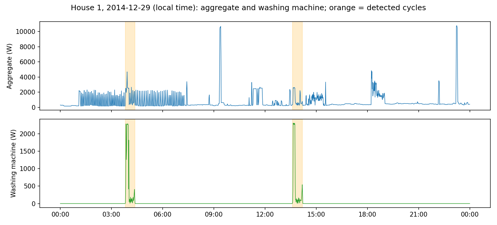
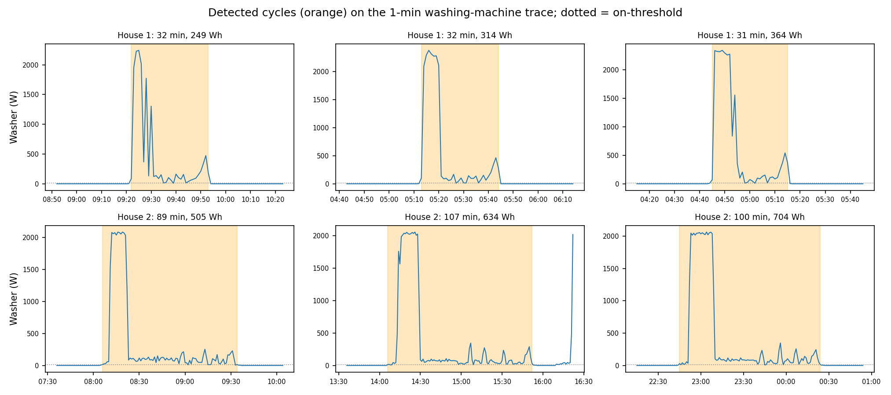
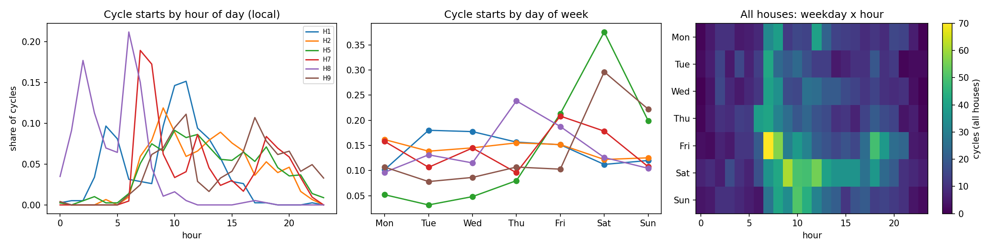
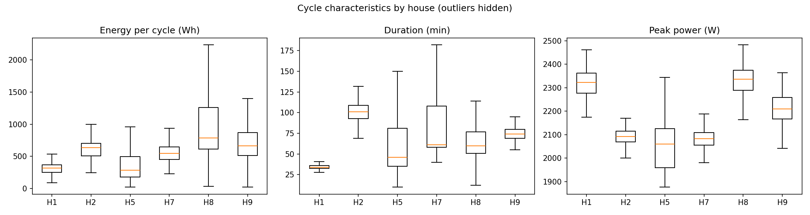
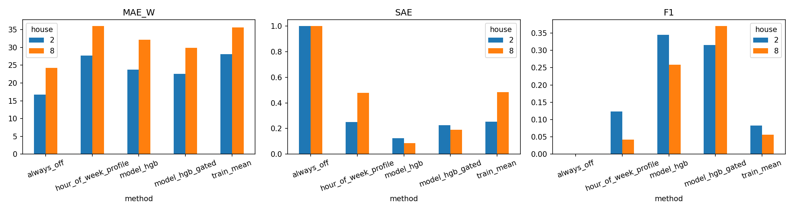
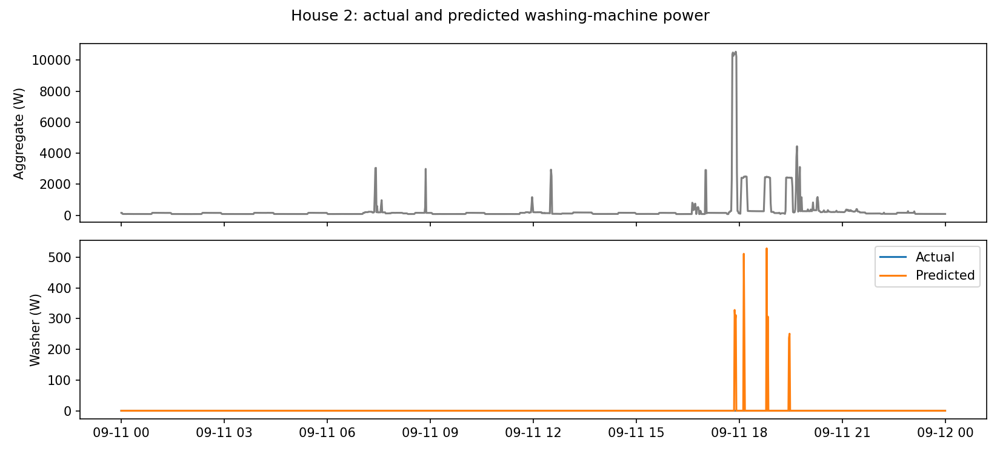
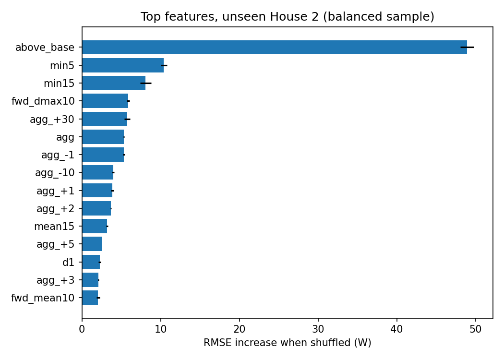
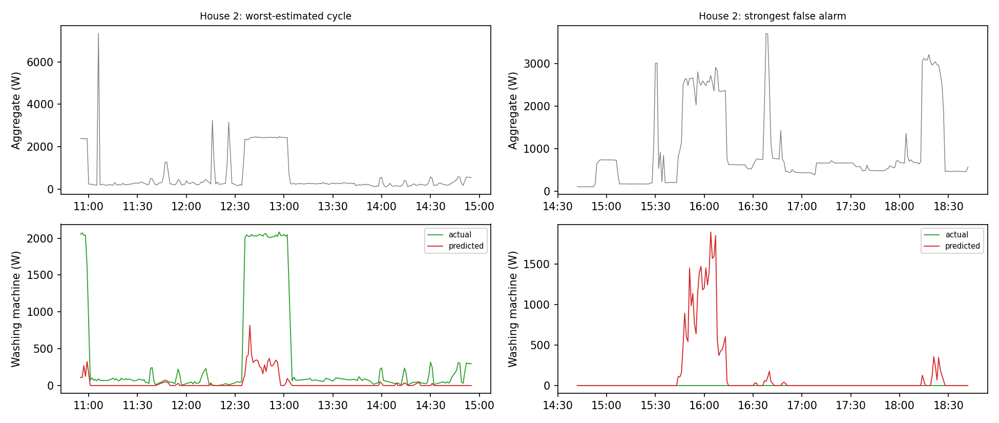

# RESULTS.md: washing-machine EDA (Task 2) and disaggregation model (Task 3)

All analysis here uses the **official cleaned REFIT data** at 1-minute resolution (the cleaned files are sampled about every 8 seconds and resampled by `src/pipeline.py`).

---

# Part A: Washing-machine exploratory analysis

## A1. Homes, periods and data quality

The washing-machine channel differs per house (from the dataset readme); washer-dryer channels were excluded on purpose. Six homes were chosen: at least 555 days of data, a low share of stuck (unchanging) aggregate readings, and at least 243 detected cycles. Houses 3 and 10 were excluded for stuck-sensor shares of 12% and 8%, Houses 4 and 6 for too few cycles, and House 11 for only 392 days.

| House | Start | End | Days | Missing % | Outages over 1 h | Longest outage (days) | Off % | Issues % | Cycles | Cycles per week | Median Wh | Median min |
|---|---|---|---|---|---|---|---|---|---|---|---|---|
| 1 | 2013-10-09 | 2015-07-10 | 638 | 12.5 | 22 | 41.6 | 98.0 | 1.8 | 383 | 4.2 | 314 | 34 |
| 2 | 2013-09-17 | 2015-05-28 | 617 | 24.6 | 78 | 62.0 | 95.0 | 1.5 | 303 | 3.4 | 634 | 101 |
| 5 | 2013-09-26 | 2015-07-06 | 648 | 9.2 | 203 | 8.6 | 91.6 | 7.6 | 788 | 8.5 | 285 | 46 |
| 7 | 2013-11-01 | 2015-07-08 | 613 | 12.5 | 23 | 41.6 | 91.5 | 4.1 | 835 | 9.5 | 546 | 61 |
| 8 | 2013-11-01 | 2015-05-10 | 555 | 10.2 | 17 | 39.1 | 96.6 | 1.5 | 373 | 4.7 | 786 | 60 |
| 9 | 2013-12-17 | 2015-07-08 | 568 | 15.3 | 14 | 41.6 | 97.3 | 2.0 | 243 | 3.0 | 660 | 74 |

(Also saved as `figures/availability_table.csv`.) "Missing" is the share of minutes with no washer data. "Issues" is the share of minutes where the appliances sum to more than the aggregate. Cycles per week is counted over calendar time including outages, so it understates the rate while the sensor was working. House 2 has the most missing data (24.6%, with a 62-day outage), so its totals need care. House 5 has many short outages and the highest Issues share.

## A2. Cycle rule

A washing machine is considered **on** when it draws more than 10 W. Pauses of up to 10 minutes are treated as part of the same cycle, because the drum rests between the wash, rinse and spin phases. An event counts as a cycle only if it lasts at least 10 minutes and uses at least 20 Wh, which removes brief blips. Cycles within 5 minutes of a sensor outage are dropped, because their start or end may be cut off. Hours and weekdays use UK local time.

I checked the rule by plotting sample cycles: each wash appears as one block, and a wash starting 20 minutes after another is kept separate. **TODO:** confirm the same check for Houses 5, 7 and 8 (`figures/cycles_detected_other_houses.png`).

## A3. One representative 24-hour trace

House 1, 29 December 2014 (local time). The washer ran twice, at about 03:50 and 13:35, each time as a 2.3 kW heating burst followed by about 30 minutes at low power. In the aggregate, the first run sits on top of a regular 2 kW on/off pattern from about 01:00 to 07:20. This looks like a thermostat-controlled heater (a guess that could be checked against the heater channel), and it hides most of the washer's heating phase. The second run stands out clearly because little else is running. Short aggregate spikes near 10 kW at about 09:25 and 22:50 are not the washer; they are probably an unmetered high-power appliance. The day is the median-energy day with at least two cycles, so it is busier than a typical House 1 day (4.2 cycles per week).

## A4. Detected cycles

Each wash shows as a short high-power heating phase of about 2 kW, followed by a long low-power phase of about 50 to 200 W (drum and pump) and a small spin bump at the end. House 1 washes last about 30 minutes, with 5 to 8 minutes of heating and 250 to 360 Wh. House 2 washes last 90 to 110 minutes, with 10 to 15 minutes of heating and 500 to 700 Wh.

## A5. Usage patterns by hour and day of week

- **Hour of day.** Most washing is in the morning and around midday, with clear differences between homes. House 7 peaks sharply at 07:00 to 08:00 (about 36% of its cycles start in those two hours). House 1 peaks at 09:00 to 11:00. House 8 runs mostly at night (00:00 to 03:00 and 06:00), which fits a timer or an off-peak tariff, though the data cannot prove that. Houses 2, 5 and 9 spread from morning to evening, and House 9 has the most evening use.
- **Day of week.** Houses 5 and 9 are strongly weekend-weighted, with Saturday taking about 38% and 30% of cycles. House 7 peaks on Friday and House 8 on Thursday (about 24%). Houses 1 and 2 are nearly flat across the week. Pooled across homes there is a hot spot on Friday 07:00 to 08:00 and a broad Saturday-morning peak.
- Shares are of detected cycles. Outages are not evenly spread over the week, so weekday shares are slightly noisy.

## A6. Cross-house comparison

Median energy per cycle ranges from about 285 Wh (House 5) to 786 Wh (House 8). Peak power clusters tightly within each house and differs between them, from about 2.05 to 2.35 kW, which fits a different heating element in each machine and works as a machine fingerprint. Durations in Houses 1, 2 and 9 are consistent (narrow boxes), while Houses 5, 7 and 8 vary much more, which suggests several programmes per house. I have not verified that explanation. **TODO:** after checking the cycle plots for Houses 5, 7 and 8, confirm or remove this sentence.

---

# Part B: Disaggregation model

## B1. Problem

Estimate the washing-machine power at 1-minute resolution using only the household aggregate. Other appliance channels are not used as inputs: the aggregate is the sum of all appliances, so using them would leak the answer, and it would make the model unusable in homes without sub-meters.

## B2. Homes and periods

| Role | Houses | Period used |
|---|---|---|
| Train | 1, 5, 7 **TODO: add any further training houses used in the final run** | full available period of each home |
| Validation | 9 | 2013-12-17 to 2015-07-08 |
| Test (unseen) | 2 and 8 | 2013-09-17 to 2015-05-28 and 2013-11-01 to 2015-05-10 |

Minutes with a missing aggregate or washer reading, or with Issues = 1, are excluded from training and scoring.

## B3. Split and how it avoids leakage

The split is **by household**, and the houses in the three sets are disjoint (the code asserts this). Splitting by home tests whether the model works in a new home, which is the realistic use, and it avoids overlapping time windows crossing between training and test. Further safeguards: features use the aggregate only; the usage-profile baseline is fitted on the training homes only; the number of boosting iterations and the output threshold are chosen on the validation home only; the test homes are used once for the final scores.

## B4. Features and model

The model is a gradient-boosted tree regressor (scikit-learn `HistGradientBoostingRegressor`; at most 300 iterations, learning rate 0.1, 31 leaves, L2 regularisation 1.0; the best number of iterations is chosen on House 9). It was chosen because it is fast, handles missing values directly, and is easy to explain.

The washer appears in the aggregate as a pattern over time (a step up of about 2 kW, a low plateau, a step down), so each minute is described by its surroundings: the aggregate at offsets from -30 to +30 minutes, centred rolling statistics over 5 to 61 minutes, the aggregate above its one-hour base load, past-only and future-only windows of 10 to 120 minutes, and step-edge detectors. Hour of day and weekday were left out so the model does not memorise one household's habits. The washer is off 91% to 98% of the time, so training keeps every minute near a cycle and 25% of the remaining minutes with weight 4, which speeds up training without shifting the average.

**Output threshold.** Predictions at or below 25 W are set to 0. The threshold was picked on House 9 to maximise ON/OFF F1. Raw and thresholded results are both reported.

## B5. Baselines and metrics

Baselines: always off; the training-set mean; and an hour-of-week usage profile fitted on the training homes.

- **MAE and RMSE (watts).** MAE is small for an always-off model because the washer is rarely on, so it is a weak judge on its own. RMSE penalises missed peaks.
- **SAE:** the total-energy error over the period. It can hide errors that cancel out, so it is read together with the other metrics.
- **Minute-level ON/OFF precision, recall and F1** at 10 W: do predicted on-minutes match the real ones?
- **Median per-cycle energy error:** how well the energy of each wash is recovered.

## B6. Results

| House | Method | MAE (W) | RMSE (W) | SAE | Precision | Recall | F1 | Median cycle energy error |
|---|---|---|---|---|---|---|---|---|
| 9 (validation) | Model (raw) | 19.15 | 111.34 | 0.599 | 0.120 | 0.939 | 0.213 | 0.545 |
| 9 (validation) | Model (thresholded) | 17.21 | 111.30 | 0.399 | 0.196 | 0.796 | 0.315 | 0.551 |
| 9 (validation) | Always off | 10.64 | 136.25 | 1.000 | 0 | 0 | 0 | 1.000 |
| 9 (validation) | Training mean | 22.52 | 135.84 | 0.176 | 0.019 | 1.000 | 0.038 | 0.976 |
| 9 (validation) | Hour-of-week profile | 22.32 | 135.72 | 0.179 | 0.029 | 0.741 | 0.056 | 0.964 |
| 2 (test) | Model (raw) | 23.77 | 147.57 | 0.125 | 0.235 | 0.648 | 0.345 | 0.768 |
| 2 (test) | Model (thresholded) | 22.55 | 147.65 | 0.227 | 0.256 | 0.410 | 0.315 | 0.784 |
| 2 (test) | Always off | 16.77 | 168.25 | 1.000 | 0 | 0 | 0 | 1.000 |
| 2 (test) | Training mean | 28.14 | 167.47 | 0.254 | 0.043 | 1.000 | 0.082 | 0.967 |
| 2 (test) | Hour-of-week profile | 27.74 | 167.12 | 0.251 | 0.067 | 0.761 | 0.123 | 0.953 |
| 8 (test) | Model (raw) | 32.12 | 179.56 | 0.086 | 0.150 | 0.935 | 0.259 | 0.684 |
| 8 (test) | Model (thresholded) | 29.88 | 179.55 | 0.192 | 0.238 | 0.827 | 0.370 | 0.685 |
| 8 (test) | Always off | 24.26 | 220.77 | 1.000 | 0 | 0 | 0 | 1.000 |
| 8 (test) | Training mean | 35.64 | 219.75 | 0.484 | 0.029 | 1.000 | 0.056 | 0.984 |
| 8 (test) | Hour-of-week profile | 36.00 | 220.44 | 0.480 | 0.022 | 0.381 | 0.042 | 0.992 |

(Also in `figures/model_metrics_rich.csv`.)

**Reading the table.** The model has the lowest RMSE in all three homes, about 12% lower than always-off on House 2 and about 19% lower on House 8, and it is the only method with a useful F1. MAE is lowest for always-off, as expected for a target that is zero most of the time, so it is not the headline. The threshold raises precision and F1 on Houses 9 and 8 but lowers F1 on House 2 and raises the total-energy error on both test homes, because it removes real low-power energy; it was tuned on a single validation home, which makes it a noisy choice. The weak points are precision (about 0.2 to 0.26 thresholded, so roughly four in five flagged minutes are not washes) and per-cycle energy (a typical error of 55% to 78%). The total-energy error should not be quoted alone: for House 2 it is 0.125 raw, yet precision is only 0.24, because over-prediction in false alarms and under-prediction on real cycles cancel out.

## B7. Actual versus predicted

**TODO:** two sentences on what the figure shows (the plot is a day on House 2, an unseen test home, with the aggregate above).

## B8. What the model relies on

Permutation importance on an unseen home (shuffling one feature at a time and measuring the rise in RMSE) shows the model relies mainly on how far the aggregate sits above its one-hour base load, plus short-window minima, step edges over the next 10 minutes, and context 30 minutes ahead or two hours back. In other words, it mostly detects a sustained step of about 2 kW above the base load, with some cycle-shape context. Importance describes what the model uses, not what is physically true, and correlated rolling windows share credit, so small differences between neighbouring features should not be over-read.

## B9. Failure analysis

1. **Loads that look like the washer.** A kettle, dishwasher, tumble dryer or heater produces a similar sustained burst of about 2 kW. The model sees only the aggregate and relies mainly on that step, so such loads cause false alarms; this is the main reason precision is low. A heater that cycles on and off can also hide the washer's heating phase, as in the House 1 day in A3. **TODO:** confirm from the figure which loads were involved.
2. **The long low-power tail.** A wash ends with 50 to 200 W for tens of minutes, which is hard to see in an aggregate whose base load and noise are of the same size. The model tends to miss or shorten the tail, so per-cycle energy is poorly recovered.
3. **Unseen machines.** Peak power ranges from about 2.05 kW to 2.35 kW and cycle length from 34 to 101 minutes between homes. A home whose machine differs from the training machines is likely to be estimated worse. Only two unseen homes were tested, so this is a risk rather than a measured effect.

## B10. Interpretation

The model is a coarse wash detector. It finds most washes in homes it has never seen (recall 0.41 to 0.83 thresholded) and beats every baseline on RMSE, but about four in five flagged minutes are not washes and the energy of individual washes is poorly recovered. It is useful for questions about when washing happens and roughly how often, and not for per-wash energy accounting. See `Recommendation.md`.
